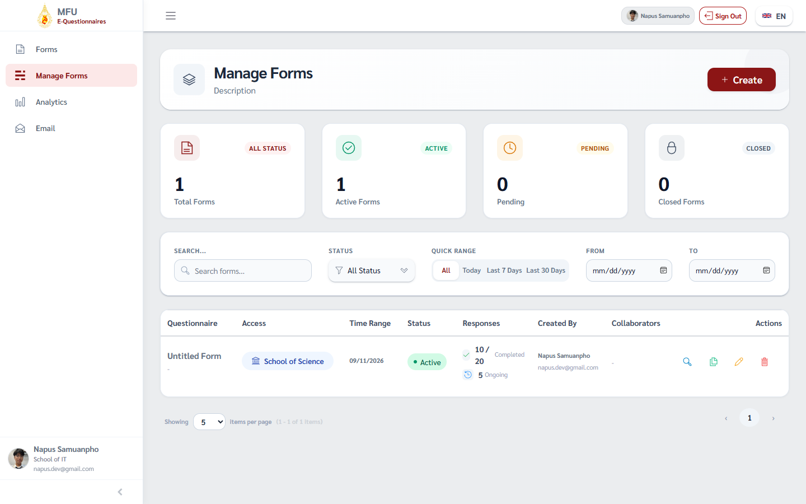
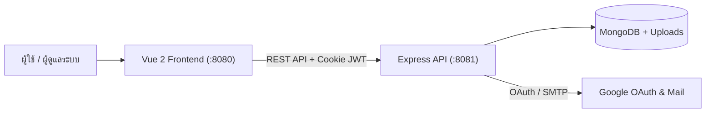

<div align="center">

# Digital University E-Questionnaires

**แพลตฟอร์มสร้าง จัดการ และวิเคราะห์แบบสอบถามออนไลน์หลายภาษาสำหรับองค์กร**




</div>

## ✨ ทำอะไรได้บ้าง

- **Form Builder & Multilingual Sync** — สร้างคำถาม 7 รูปแบบ (เช่น Rating, File Upload, Multiple Choice) พร้อมจัดการหลายภาษา (EN/TH) ทั้งฟอร์ม
- **Role & Organization Access Control** — จำกัดกลุ่มเป้าหมายตามหน่วยงาน/คณะ แยกหน้า `/manage` (ผู้สร้าง/ผู้ร่วมงาน) กับ `/forms` (ผู้ตอบ) และนับยอด `Completed / Target` + `Ongoing`
- **File Upload & Analytics** — อัปโหลดไฟล์หลายรายการพร้อมบันทึกร่างอัตโนมัติ ดูสรุปกราฟ รายละเอียดรายบุคคล และส่งออก Excel/JSON

## 🧭 ระบบทำงานยังไง



ผู้ใช้เข้าใช้งานผ่านหน้าเว็บ Vue 2 ซึ่งเรียก Express API พร้อมตรวจสอบสิทธิ์ผ่าน Google OAuth และ JWT Cookie ข้อมูลแบบสอบถาม คำตอบ และไฟล์แนบจะถูกบันทึกใน MongoDB และโฟลเดอร์ `uploads/` ของเซิร์ฟเวอร์โดยตรง

## 🚀 เริ่มใช้งานใน 5 นาที

**ต้องมีก่อน:** Node.js 20+, Git, และ MongoDB (Local หรือ MongoDB Atlas URI)

```bash
git clone https://github.com/Napus-BackendDev/Digital-University-Project-SE.git
```

```bash
cd Digital-University-Project-SE
```

1. **ติดตั้งและรัน Backend** (รันจากโฟลเดอร์ `backend/`):

```bash
cd backend
npm install
cp .env.example .env
# แก้ค่า MONGODB และ JWT_SECRET ใน backend/.env ให้ตรงกับเครื่องของคุณ
npm start
```

2. **ติดตั้งและรัน Frontend** (เปิดเทอร์มินัลอีกบาน แล้วรันจากโฟลเดอร์ `frontend/`):

```bash
cd frontend
npm install --legacy-peer-deps --ignore-scripts
cp .env.example .env
npm run serve
```

เปิด **http://localhost:8080** — ถ้าเห็นหน้าแบบภาพด้านบน แปลว่าพร้อมใช้แล้ว 🎉

## ⚙️ ค่าที่ต้องตั้ง (.env)

### `backend/.env`

| ชื่อ | ใช้ทำอะไร | จำเป็น? | ตัวอย่าง |
| --- | --- | --- | --- |
| `PORT` | พอร์ตของ Backend API | ใช่ | `8081` |
| `MONGODB` | URI เชื่อมต่อฐานข้อมูล MongoDB | ใช่ | `mongodb://127.0.0.1:27017/e_questionnaires` |
| `JWT_SECRET` | คีย์ลับสำหรับลงนาม Session JWT | ใช่ | `replace-with-random-64-char-hex` |
| `FRONTEND_URL` | Origin ที่อนุญาต CORS | ใช่ | `http://localhost:8080` |
| `GOOGLE_CLIENT_ID` | Client ID สำหรับ Google Sign-In | ถ้าใช้ Login | `your-client-id.apps.googleusercontent.com` |
| `SMTP_HOST`, `SMTP_PORT`, `SMTP_USER`, `SMTP_PASS` | ตั้งค่าส่งอีเมลแจ้งเตือน/เชิญ | ไม่บังคับ | `smtp.gmail.com` / `587` |

### `frontend/.env`

| ชื่อ | ใช้ทำอะไร | จำเป็น? | ตัวอย่าง |
| --- | --- | --- | --- |
| `VUE_APP_API_BASE_URL` | Base URL ของ Backend API | ใช่ | `http://localhost:8081/api/v1/` |
| `VUE_APP_GOOGLE_CLIENT_ID` | Client ID สำหรับปุ่ม Google Sign-In | ถ้าใช้ Login | `your-client-id.apps.googleusercontent.com` |

ห้ามใส่ค่าจริงหรือรหัสลับลงไฟล์ที่ commit

## 🛠️ ติดปัญหา?

| อาการ | วิธีแก้ |
| --- | --- |
| `npm install` ใน `frontend/` ติด peer dependency หรือ `deasync` / `node-gyp` error | ใช้คำสั่ง `npm install --legacy-peer-deps --ignore-scripts` |
| Backend ไม่สตาร์ตเพราะ `JWT_SECRET environment variable is required` | ตรวจสอบว่าสร้าง `backend/.env` แล้วใส่ค่า `JWT_SECRET` และ `MONGODB` |
| อัปโหลดไฟล์แล้วรูปไม่แสดงหรือเรียก API ไม่ได้ | ตรวจว่า `VUE_APP_API_BASE_URL` และ `FRONTEND_URL` ชี้ตรงพอร์ตที่รันจริง |

## 📄 License

[MIT](LICENSE) — ใช้ แก้ และแจกต่อได้ โดยคงข้อความลิขสิทธิ์ไว้

## 👤 ผู้พัฒนา

**Napus Samuanpho**
GitHub: @Napus Samuanpho · Contact: [napus.dev@gmail.com](mailto:napus.dev@gmail.com)
